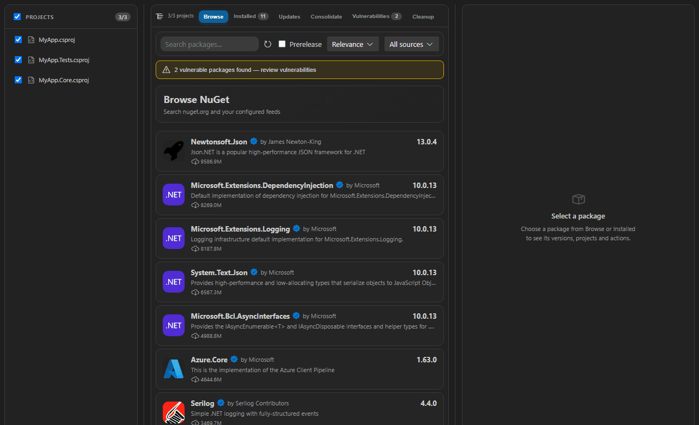
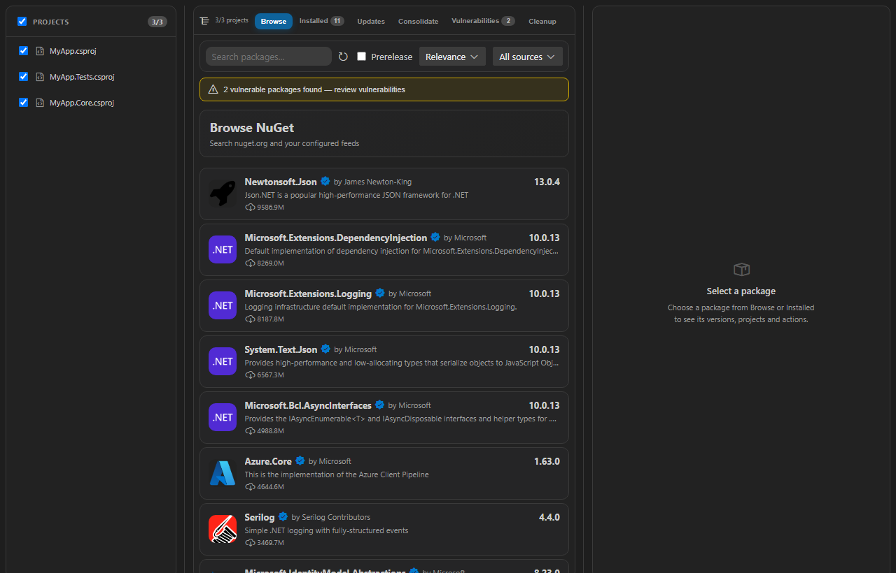
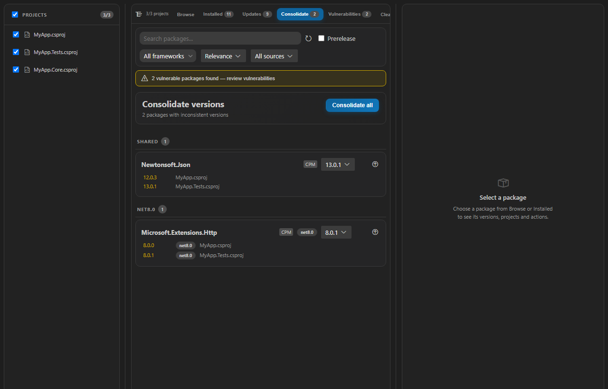
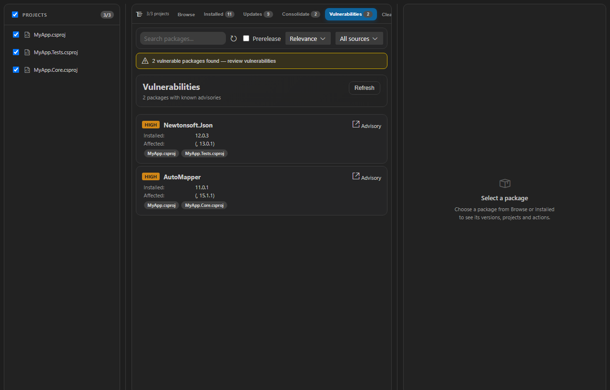
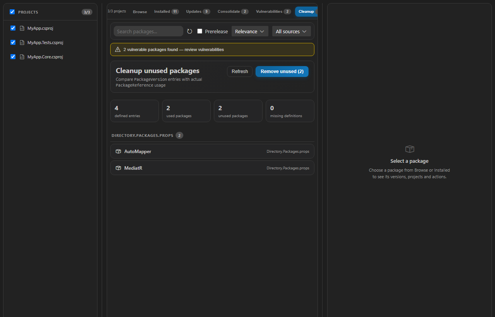
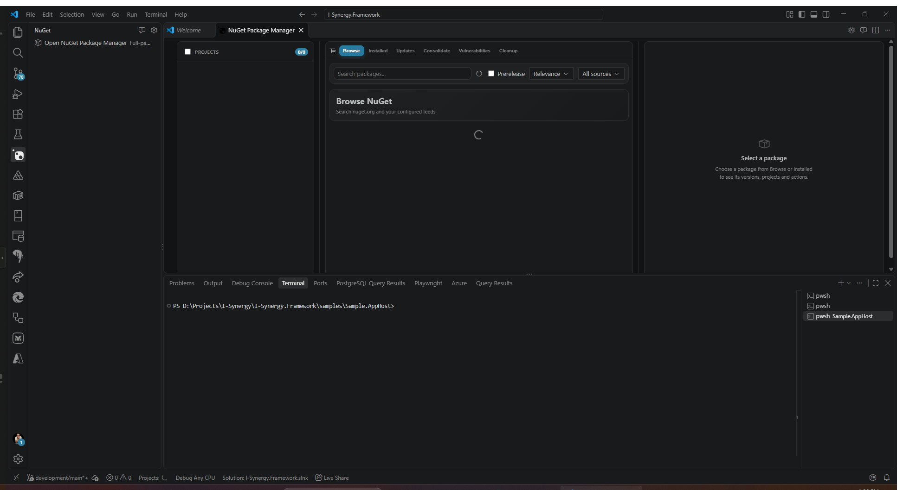
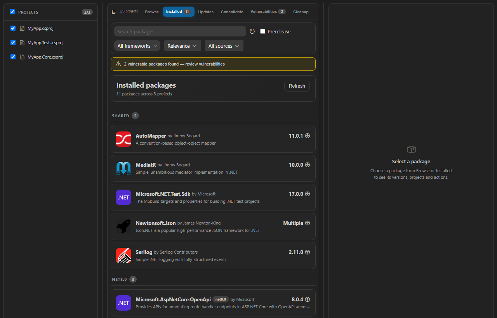
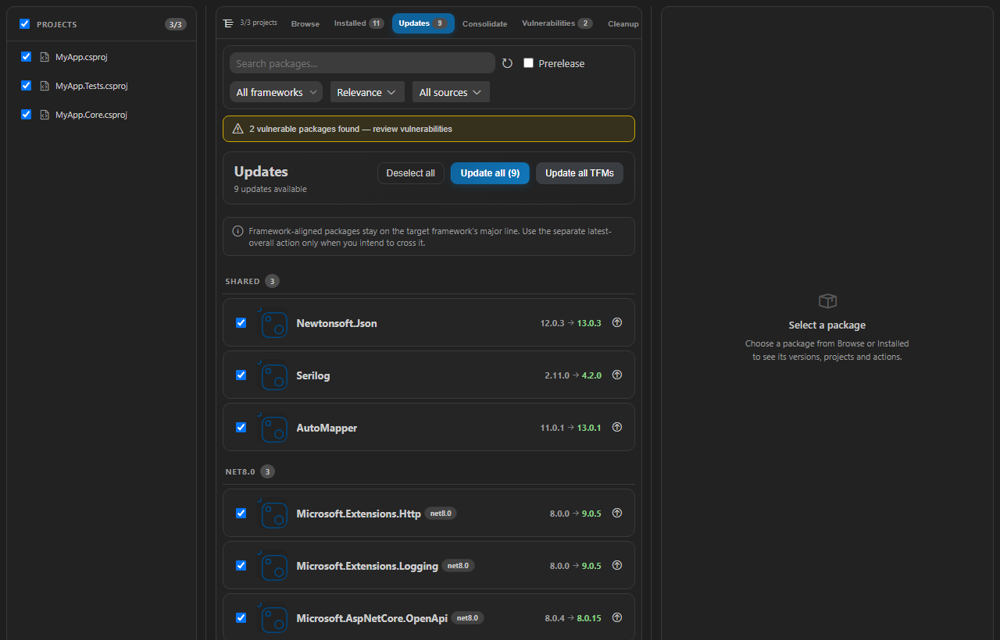

# NuGet Package Manager for Visual Studio Code

**A full-featured NuGet package manager for Visual Studio Code** — browse, install, update, and audit packages across all your .NET projects without leaving the editor.

[](https://marketplace.visualstudio.com/items?itemName=I-Synergy.nugetpackagemanager)
[](https://github.com/I-Synergy/NugetPackageManager/actions/workflows/ci.yml)
[](https://github.com/I-Synergy/NugetPackageManager/actions/workflows/quality-gate.yml)
[](https://sonarcloud.io/summary/new_code?id=I-Synergy_NugetPackageManager)
[](https://sonarcloud.io/summary/new_code?id=I-Synergy_NugetPackageManager)
[](https://sonarcloud.io/summary/new_code?id=I-Synergy_NugetPackageManager)
[](https://sonarcloud.io/summary/new_code?id=I-Synergy_NugetPackageManager)
[](https://marketplace.visualstudio.com/items?itemName=I-Synergy.nugetpackagemanager)
[](https://marketplace.visualstudio.com/items?itemName=I-Synergy.nugetpackagemanager)
[](https://marketplace.visualstudio.com/items?itemName=I-Synergy.nugetpackagemanager)
[](https://marketplace.visualstudio.com/items?itemName=I-Synergy.nugetpackagemanager)
[](LICENSE)
[](https://code.visualstudio.com/)

---



---

## Table of Contents

- [Features](#features)
- [Requirements](#requirements)
- [Installation](#installation)
- [Getting Started](#getting-started)
- [Tabs and Workflows](#tabs-and-workflows)
  - [Browse](#browse)
  - [Installed](#installed)
  - [Updates](#updates)
  - [Consolidate](#consolidate)
  - [Vulnerabilities](#vulnerabilities)
  - [Cleanup](#cleanup)
- [Activity Bar and Background Checks](#activity-bar-and-background-checks)
- [Project Tree](#project-tree)
- [Commands](#commands)
- [Configuration](#configuration)
- [Private Feed Authentication](#private-feed-authentication)
- [Central Package Management](#central-package-management)
- [Inline Version Decorations](#inline-version-decorations)
- [Contributing](#contributing)
- [Architecture](#architecture)
- [Credits](#credits)
- [License](#license)

---

## Features

| | Feature | Description |
|---|---|---|
| 📦 | **Browse & Install** | Search nuget.org and private feeds, install into one or multiple projects at once |
| 🖥️ | **Full-page workspace** | Opens in an editor tab from the NuGet Activity Bar icon, with a compact sidebar launcher and restored panel state |
| 🔔 | **Update badge** | The Activity Bar icon shows the available-update count, and its tooltip also reports updates blocked by dependency conflicts; it refreshes from the extension host every 15 minutes |
| 📊 | **Real-time Progress** | Animated spinner during install/update operations, showing which package is being processed |
| 🔄 | **Transactional updates** | Packages are written one at a time, restored once after the complete set, and rolled back if a write or restore fails |
| 🛡️ | **Vulnerability Scanning** | Critical / High / Medium / Low severity, advisory links, transitive dependencies and a yellow banner across every tab |
| 🗑️ | **Remove from Solution** | Remove a package reference from one project or from every project in the solution at once |
| 🔀 | **Version Consolidation** | Finds and fixes version inconsistencies per framework line, never merging netX versions |
| 🧹 | **Cleanup** | Find and remove unused `PackageVersion` entries from `Directory.Packages.props`, with automatic backups |
| 🌲 | **Project Tree** | Checkbox-based project selector — scope every operation to exactly the projects you want |
| 🔐 | **Private Feeds** | Reads `NuGet.config`, supports Azure Artifacts Credential Provider and custom password scripts |
| 📌 | **CPM Support** | Full Central Package Management — detects `Directory.Packages.props`, tracks version sources |
| ✏️ | **Inline Decorations** | Optional gutter hints in `.csproj` files showing available updates right in the editor |
| ⌨️ | **Keyboard Accessible** | Full keyboard navigation and ARIA support across all interactive elements |

---

## Requirements

- Visual Studio Code **1.110** or later
- A workspace containing `.csproj`, `.fsproj`, `.vbproj`, `.sln`, or `.slnx` files
- **.NET SDK** installed and on `PATH` (for install / update / restore operations)

---

## Installation

### From the Marketplace (recommended)

1. Open VS Code
2. Press `Ctrl+Shift+X` to open the Extensions panel
3. Search for **NuGet Package Manager for Visual Studio Code**
4. Click **Install**

Or install directly from the command line:

```bash
code --install-extension I-Synergy.nugetpackagemanager
```

### From a .vsix file

Download the latest `.vsix` from the [Releases page](https://github.com/I-Synergy/NugetPackageManager/releases), then:

```bash
code --install-extension nugetpackagemanager-x.x.x.vsix
```

Or via the Extensions panel: click **···** → **Install from VSIX…**

---

## Getting Started

1. Open a folder or workspace that contains `.csproj` / `.fsproj` / `.vbproj` / `.sln` / `.slnx` files — the extension activates automatically.
2. Click the **NuGet** icon in the Activity Bar. The full-page workspace opens in an editor tab; the sidebar icon stays available as a launcher.
3. Your projects appear in the **project tree** on the left. All are selected by default.
4. Use the **Browse** tab to search for and install packages.
5. Run **Updates** to check for outdated packages, **Vulnerabilities** for security issues, **Consolidate** for version drift, and **Cleanup** for unused CPM entries.
6. The Activity Bar badge shows how many updates are available; it refreshes in the background every 15 minutes while the icon is visible.

> **Tip:** Use the Command Palette (`Ctrl+Shift+P`) and type `NuGet Package Manager for Visual Studio Code` to jump directly to any feature.

---

<a id="tabs-and-workflows"></a>
## Tabs and Workflows

### Browse



Search nuget.org (or any configured feed) and install packages into your projects.

- **Search bar** at the top — results update as you type
- **Source dropdown** — filter to a specific feed or search across all
- **Prerelease toggle** — include pre-release versions in results
- **Package list** (left pane) — click any row to load full details
- **Detail panel** (right pane) — description, authors, download count, license, tags, version picker, and per-project install/uninstall buttons
- **Project rows** — show the currently installed version per project; install, update to a specific version, or uninstall individually
- **Spinner** — while an install or update runs, an animated spinner replaces the action button, making it clear which package is being processed
- **Error recovery** — if the package feed fails to load, a retry button appears inline

### Installed

Shows every package installed across all selected projects. Select a package to open its details:

- **Per-project uninstall** — use the remove action on an individual project row
- **Remove from all projects** — removes the package reference from every project in the solution, confirms the project list first, and restores once after the removals
- **CPM cleanup** — when the last project reference is removed, the matching `PackageVersion` entry is deleted from `Directory.Packages.props` so no stale global reference remains
- **Version changes** — install, update, or change a package version per project without leaving the package list
- **Framework filter** — collapses platform TFMs (windows, android, ios) to their base `.NET` line. **Shared** is a separate option, so unconditional versions are never mixed into a `.NET`-specific update run.

### Updates


Lists all packages where a newer version is available on the configured sources.

- Each row shows the **installed version → latest version** with source attribution
- **Select individual packages** with checkboxes, then click **Update selected** or **Update all**
- Packages are written **one at a time**, with per-package progress; the Activity Bar badge updates as rows clear
- `dotnet restore` runs **once after all selected versions are written**, so dependent packages resolve against the complete set
- If a write or the final restore fails, the host restores the affected file snapshots and reports a rollback. Single-package installs, updates and uninstalls take the same snapshot and roll back when their restore fails.
- Updates run as a **host-side job** with live stage/percentage progress, so a large solution that takes minutes to restore is never interrupted by a webview request deadline. The same applies to single installs, updates, uninstalls, consolidation and cleanup. A job keeps running if the tab is closed, and only one batch update runs at a time so two transactions cannot overwrite each other.
- A webview request deadline no longer cancels host work: timeouts report that the operation is still running instead of reverting packages that were written successfully. A rollback happens only for a real write/restore failure or an explicit cancel.
- Before writing, a multi-package update is checked against the restored dependency graph. Selections that would break a pin are listed in a confirmation dialog and the conflicting rows are skipped, so one incompatible package does not fail the other 63. If the final restore still fails, the rollback names the packages involved and offers to retry without them.
- The restore phase reports `dotnet`'s own stages per project, and the progress banner has a **Cancel** button that rolls back what was already written. Cancel is also available on a busy project row, on a consolidating card, during cleanup, and during "remove from all projects" (which stops before touching the remaining projects).
- The extension **never runs `dotnet build`**. After writing versions it runs `dotnet restore` only; building or rebuilding is left to your own build task or `dotnet build`.
- Restore failures report the actual `dotnet` diagnostics. For `NU1107` the message names the contested package and the dependency chains, for example `Npgsql.EntityFrameworkCore.PostgreSQL 11.0.0-rc.2 requires = 11.0.0-rc.2.26504.105`.
- **Dependency-aware suggestions** — when an installed package pins a version of another package (for example an EF Core provider pinning `Microsoft.EntityFrameworkCore.Relational`), the suggested update is capped to a version those ranges accept. Unsafe versions are listed under **Dependency conflicts** with the installed version, the blocked version, and the packages/ranges that block it; the row's lock icon carries the same detail, and the separate latest-overall action still lets you override the pin deliberately.
- **Warm start** — the last scan is persisted per workspace. The tab paints those rows immediately (marked as cached, with update actions disabled) and refreshes in the background, so switching to Updates does not wait for the network.
- **Local metadata cache** — NuGet registration/search responses are cached on disk for 30 minutes under the extension's global storage. **Reload** bypasses the in-memory caches and clears the HTTP cache.
- Per-row **update button** for single-package updates
- **Framework selector** — choose **All frameworks**, **Shared**, or a base `.NET` line such as `net10.0` / `net11.0`. Platform variants are grouped under the base line; selecting a `.NET` line excludes shared packages.
- Tab data refreshes automatically every time you switch to it

### Consolidate



Detects packages that are installed at different versions across your projects.

- Groups packages by ID, shows which project uses which version (latest highlighted in orange, older in yellow)
- **Version dropdown** per package — pick the target version to consolidate to
- **Consolidate** button applies to a single package; **Consolidate all** processes each framework line separately
- **Framework selector** — review **Shared** separately from the base `.NET` lines; platform TFMs are grouped under their base line
- Respects Central Package Management and never merges one framework's version into another
- Tab data refreshes automatically every time you switch to it

### Vulnerabilities



Scans installed packages against the NuGet vulnerability database, including dependencies.

- **Direct and transitive packages** are scanned; transitive rows come from `project.assets.json`
- Transitive entries are marked **transitive** and show **Via:** direct package(s) that pull them in
- Severity badges: **CRITICAL** · **HIGH** · **MEDIUM** · **LOW**
- Affected version range and affected projects are shown for each entry
- **Advisory** link opens the GitHub Security Advisory in your browser
- A **yellow vulnerability banner is shown across every tab** and links directly to Vulnerabilities
- Tab data refreshes automatically every time you switch to it

---

### Cleanup

Finds `PackageVersion` entries in `Directory.Packages.props` that no project references and removes them safely.

- Compares global CPM versions against every `PackageReference` in the workspace
- Groups unused entries by props file
- Shows **used but not defined** references so missing CPM entries are visible
- Creates a timestamped backup of each props file before removing anything
- Removes all conditional groups for a package when the package is unused



Use **Remove unused** after reviewing the list. This replaces the PowerShell `Remove-UnusedPackages.ps1` workflow with an in-editor report and confirmation.

---

<a id="activity-bar-and-background-checks"></a>
## Activity Bar and Background Checks



- The NuGet entry is hidden in workspaces without a supported .NET project
- Clicking it opens the full-page workspace in an editor tab; the sidebar launcher remains available
- The icon badge shows the number of available updates; its tooltip also reports updates blocked by dependency conflicts
- Update checks run from the extension host **every 15 minutes** while the extension is active and the workspace contains a supported project, even when the page is closed
- Background scans and timers stop when the workspace has no supported project or the extension deactivates

---

## Project Tree

The collapsible project tree on the left of the main view lets you scope operations:

- **Check / uncheck** individual projects to include or exclude them from searches and batch operations
- **Selected/total project count** and target-framework metadata are shown in the tree header and rows
- Supports C# (`.csproj`), F# (`.fsproj`), and VB.NET (`.vbproj`) project files
- Projects discovered recursively from the workspace root, excluding `node_modules`, `bin`, `obj`

---

## Commands

Access these from the Command Palette (`Ctrl+Shift+P`):

| Command | ID | Description |
|---|---|---|
| **NuGet Package Manager for Visual Studio Code: Open Packages** | `nugetpackagemanager.open` | Open or reveal the full-page NuGet editor tab |
| **NuGet Package Manager for Visual Studio Code: Add Package** | `nugetpackagemanager.install` | Prompt for a package ID and open Browse with it pre-searched |
| **NuGet Package Manager for Visual Studio Code: Update Package** | `nugetpackagemanager.update` | Open the editor tab and switch to Updates |
| **NuGet Package Manager for Visual Studio Code: Remove Package** | `nugetpackagemanager.remove` | Open the editor tab and switch to Installed |
| **Settings** | `nugetpackagemanager.openSettings` | Open the NuGet Package Manager for Visual Studio Code settings view |
| **Report Problem** | `nugetpackagemanager.reportProblem` | Open a new GitHub issue |

---

## Configuration

Open VS Code Settings (`Ctrl+,`) and search for **NuGet Package Manager for Visual Studio Code**, or edit `settings.json` directly.

| Setting | Type | Default | Description |
|---|---|---|---|
| `nugetpackagemanager.sources` | `string[]` | `[nuget.org]` | List of NuGet feed URLs to search and update from. Each entry is a JSON string `{"name":"...","url":"..."}`. |
| `nugetpackagemanager.prerelease` | `boolean` | `false` | Include pre-release versions when checking for updates. |
| `nugetpackagemanager.skipRestore` | `boolean` | `false` | Skip the restore preview and compatibility check when installing/updating packages. |
| `nugetpackagemanager.enablePackageVersionInlineInfo` | `boolean` | `false` | Show inline gutter decorations in `.csproj` files with available update versions. |
| `nugetpackagemanager.statusBarLoadingIndicator` | `boolean` | `false` | Show a loading progress indicator in the VS Code status bar. |
| `nugetpackagemanager.logLevel` | `"DEBUG"` \| `"INFO"` \| `"WARN"` \| `"ERROR"` | `"INFO"` | Minimum log level written to the NuGet Package Manager for Visual Studio Code output channel. |
| `nugetpackagemanager.frameworkAlignedPackages` | `string[]` | `["Microsoft.Extensions.*", "Microsoft.AspNetCore.*", "Microsoft.EntityFrameworkCore.*", "Microsoft.Maui.*", "System.*"]` | Package patterns whose major version follows the target framework (net10.0 → 10.x). Keeps framework-scoped update suggestions on the matching major line. |
| `nugetpackagemanager.extraTargetFrameworks` | `string[]` | `[]` | Target frameworks added when MSBuild evaluation is unavailable or incomplete (for example `net11.0`). |
| `nugetpackagemanager.excludeGlobs` | `string[]` | `["**/bin/**", "**/obj/**", "**/TestResults/**", "**/packages/**", "**/.git/**"]` | Glob patterns excluded from project discovery. |
| `nugetpackagemanager.passwordScriptAllowlist` | `string[]` (machine scope) | `[]` | Directories from which password scripts may run. Workspace-provided script paths outside this list are refused; scripts also require a trusted workspace. |
| `nugetpackagemanager.enableTelemetry` | `boolean` | `false` | Opt in to anonymous OTLP telemetry (requires VS Code telemetry and `TELEMETRY_ADDRESS`). |
| `nugetpackagemanager.updateCheckConcurrency` | `number` | `8` | Number of packages whose latest version is checked concurrently in the Updates tab (1–32). |

> **Breaking rename:** this release uses only the `nugetpackagemanager.*` settings and commands. Settings from the previous `i-synergy-nugetpackagemanager.*` namespace are not migrated (old keys may appear as unknown settings in `settings.json`), and the old `nugetpackage.*` command IDs are no longer registered.

> **Security:** the extension declares `capabilities.untrustedWorkspaces.supported: false` and refuses password scripts unless the workspace is trusted. `%VAR%` expansion in a workspace `nuget.config` is deliberately not performed, so a repository cannot read your environment variables.

### Example `settings.json`

```jsonc
{
  "nugetpackagemanager.sources": [
    "{\"name\": \"nuget.org\", \"url\": \"https://api.nuget.org/v3/index.json\"}",
    "{\"name\": \"My Feed\",   \"url\": \"https://pkgs.dev.azure.com/my-org/_packaging/my-feed/nuget/v3/index.json\"}"
  ],
  "nugetpackagemanager.prerelease": false,
  "nugetpackagemanager.enablePackageVersionInlineInfo": true,
  "nugetpackagemanager.skipRestore": false,
  "nugetpackagemanager.logLevel": "INFO"
}
```

---

## Private Feed Authentication

NuGet Package Manager for Visual Studio Code supports private package feeds out of the box.

### NuGet.config (automatic)

The extension reads credentials stored in any `NuGet.config` file in your workspace or the global `%APPDATA%\NuGet\NuGet.Config`. If your feed credentials are already configured there, no extra setup is needed.

### Local folder feeds

Local folder sources are supported as well. A `nuget.config` source whose value is a directory is scanned recursively for `.nupkg` files; package metadata and versions come from the embedded `.nuspec`. Flat folders and the standard `package-id/version/*.nupkg` layout both work. Local sources have no vulnerability endpoint, so vulnerability results are empty for those packages.

```xml
<packageSources>
  <add key="Local packages" value="D:\LocalNuGetPackages" />
</packageSources>
```

### Azure Artifacts Credential Provider

Install the [Microsoft Artifacts Credential Provider](https://github.com/microsoft/artifacts-credprovider) and authenticate once via the .NET CLI:

```bash
dotnet restore --interactive
```

The credential provider handles token refresh automatically.

### Custom Password Script

For non-standard authentication flows, configure a script path per source. The script receives the feed URL as an argument and must print the password to stdout:

```jsonc
// settings.json
{
  "nugetpackagemanager.sources": [
    "{\"name\": \"Internal\", \"url\": \"https://my.internal.feed/v3/index.json\", \"passwordScriptPath\": \"/path/to/get-token.sh\"}"
  ]
}
```

---

<a id="central-package-management"></a>
<a id="central-package-management-cpm"></a>
## Central Package Management

NuGet Package Manager for Visual Studio Code has first-class support for [Central Package Management](https://learn.microsoft.com/en-us/nuget/consume-packages/central-package-management).

- **Auto-detection** — projects using `Directory.Packages.props` are detected and labelled in the project tree
- **Version source tracking** — each installed package shows whether its version comes from `project`, `central`, or `override`
- **Framework-scoped versions** — conditional `<ItemGroup Condition="...">` groups are evaluated per target framework, so the same package can show and update different versions for `net10.0` and `net11.0`
- **Aligned updates** — for runtime-aligned packages (`Microsoft.Extensions.*`, `Microsoft.AspNetCore.*`, `Microsoft.EntityFrameworkCore.*`, `Microsoft.Maui.*`, `System.*`), the primary update stays on the framework's major line; the overall latest version is offered as a separate action
- **Consolidate** — understands CPM boundaries and applies consolidation correctly, scoped to the same framework group
- **Restore handling** — uses the correct `dotnet` invocation for CPM workspaces
- **Source mapping** — `<packageSourceMapping>` in `nuget.config` is honoured when looking up package versions

### Multi-framework version management

A `Directory.Packages.props` file can define several version lines for the same package:

```xml
<ItemGroup>
  <PackageVersion Include="Common.Library" Version="1.0.0" />
</ItemGroup>
<ItemGroup Condition="!$(TargetFramework.StartsWith('net11.0'))">
  <PackageVersion Include="Microsoft.Extensions.Logging" Version="10.0.13" />
</ItemGroup>
<ItemGroup Condition="$(TargetFramework.StartsWith('net11.0'))">
  <PackageVersion Include="Microsoft.Extensions.Logging" Version="11.0.0-rc.2.26504.105" />
</ItemGroup>
```

The extension evaluates each condition against the project's real target frameworks (using `dotnet msbuild -getProperty`), then:

1. shows one row per framework line in **Installed**, **Updates** and **Consolidate**;
2. labels negated groups distinctly (`not net11.0`) so positive and negated conditions do not collapse;
3. writes only inside the `ItemGroup` that produced the row;
4. batches all changes for a shared props file into a single read/write cycle.

Use the framework dropdown to focus on one base `.NET` line, **Shared** for unconditional versions, or **All frameworks**; platform TFMs (windows/android/ios) are grouped under their base `.NET` line. Selecting a `.NET` line excludes shared packages, so shared versions are updated in a separate run. **Update all TFMs** remains an explicit cross-framework action. Values that do not follow the TFM major — for example a stable `10.x` package in a `net11.0` line — require the explicit *latest overall* action, which is shown with a warning.





---

## Inline Version Decorations

Enable `nugetpackagemanager.enablePackageVersionInlineInfo` to see available updates directly in your project files:

```xml
<PackageReference Include="Newtonsoft.Json" Version="12.0.3" />  ← 13.0.3 available
```

Decorations appear in the gutter next to `<PackageReference>` entries whenever a newer version exists on your configured sources. They are informational.

---

## Contributing

Contributions are welcome — bug reports, feature requests, documentation improvements, and pull requests.

### Reporting Issues

Please use the [GitHub Issues](https://github.com/I-Synergy/NugetPackageManager/issues) tracker. Include:
- VS Code version
- Extension version
- Steps to reproduce
- Relevant output from the **NuGet Package Manager for Visual Studio Code** output channel (set `logLevel` to `DEBUG`)

### Development Setup

**Prerequisites:** Node.js 19+, npm

```bash
# 1. Clone the repository
git clone https://github.com/I-Synergy/NugetPackageManager.git
cd NugetPackageManager

# 2. Install dependencies
npm install

# 3. Build the extension
npm run esbuild

# 4. Start the UI dev server (browser, no VS Code needed)
npm run dev
```

### Running & Debugging

Press **F5** in VS Code to launch a new Extension Development Host window with the extension loaded. The host reloads automatically after `npm run esbuild`.

To iterate on the UI without a full VS Code instance, use the **Run Mock Extension (Browser)** launch configuration. It builds the web bundle and starts the dev server at `http://localhost:3729`, loading the UI with realistic mock NuGet data (packages, projects, vulnerabilities, etc.) injected via `tools/mock-api.js`. No `.csproj` files or dotnet CLI required.

Alternatively, run it directly from the terminal:

```bash
npm run dev
```

### Code Style

```bash
npm run lint          # Check for lint errors (ESLint 9)
npm run lint:fix      # Auto-fix fixable issues
```

- **TypeScript strict mode** — `any` is a warning, avoid it
- Unused variables: prefix with `_` to suppress the warning
- CSS in Lit components uses the `css` tagged template literal and VS Code CSS variables (`--vscode-*`)
- All written content in English: code comments, commit messages, JSDoc, documentation

### Running Tests

```bash
npm test              # Full test suite (VSCode Test CLI + Mocha)
npm run test-compile  # Compile tests to out/ (required before npm test)
```

Tests live alongside source files as `*.test.ts`. The test runner opens a headless VS Code Extension Host.

### Quality Gate

The same checks run locally and in CI (`.github/workflows/quality-gate.yml`):

```bash
npm run quality            # build, lint (ESLint + SonarJS), type check, tests, npm audit
npm run quality:coverage   # same, and writes coverage/lcov.info for SonarCloud
```

`npm run quality` must pass before a commit is pushed. The gate treats correctness and
security findings from `eslint-plugin-sonarjs` as errors and reports known
maintainability debt (complexity, nesting, regex cost) as warnings. The workflow also
runs a SonarQube Cloud scan and waits for the server-side quality gate
(`sonar.qualitygate.wait=true`) when the `SONAR_TOKEN` repository secret is configured;
without it, the scan step is skipped with a warning.


### Updating Screenshots

After UI changes, regenerate the screenshots and animated GIF automatically:

```bash
npm run esbuild          # Rebuild bundles first
npm run docs             # Generates docs/images/*.png and docs/images/demo.gif
```

The script (`tools/generate-docs.mjs`) starts a local HTTP server, loads the UI with mock data in a headless Chromium browser via Playwright, captures each tab, and assembles the animated GIF.

### Building a .vsix Package

```bash
npm run package
# → releases/nugetpackagemanager-x.x.x.vsix
```

### Pull Request Guidelines

1. Fork the repository and create a feature branch from `main`
2. Make your changes — small, focused PRs are easier to review
3. Add or update tests for changed behaviour
4. Run `npm run lint` and `npm test` — both must pass
5. Write a clear PR description explaining the **why**, not just the **what**
6. Reference any related issues with `Closes #123`

Commit messages follow [Conventional Commits](https://www.conventionalcommits.org/):
`feat:`, `fix:`, `refactor:`, `chore:`, `docs:`, `test:`, `perf:`

---

## Architecture

The extension runs in two isolated processes that communicate via a typed RPC layer over `postMessage`:

```
┌─────────────────────────────────────────────┐   ┌──────────────────────────────────────────────┐
│  VS Code Extension Host  (Node.js)           │   │  Webview  (Browser / Lit)                    │
│                                             │   │                                              │
│  extension.ts                               │   │  main.ts  →  nuget-package-manager (root element) │
│  host-api.ts  ──  RpcHost                  │◄──►│  RpcClient  →  packages-view                │
│  nuget/api.ts  (axios → NuGet API)         │   │  components/*  (@state, @property)           │
│  utilities/  (csproj parser, decorator)    │   │  registrations.ts  (singletons)              │
└─────────────────────────────────────────────┘   └──────────────────────────────────────────────┘
         postMessage RPC: { type, id, method, params } / { type, id, result }
```

**Key design decisions:**

- **Typed RPC** — `HostAPI` interface in `src/common/rpc/types.ts` is the single source of truth for all IPC. Every method returns `Result<T>` (a discriminated union), so error paths are always explicit.
- **Marketplace-style full-page UI** — the entire interface opens in an editor tab with framework-grouped cards, a sidebar launcher and VS Code theme-aware surfaces.
- **Lit web components** — built with LitElement + native HTML elements styled via VS Code CSS variables. No frameworks, no heavy dependencies in the webview bundle.
- **Dual bundle** — esbuild produces two separate bundles: `dist/extension.js` (Node.js CommonJS for the host) and `dist/web.js` (ESM for the webview).

**Source layout:**

```
src/
├── common/            # Shared between host and web (types, RPC protocol, utilities)
│   ├── rpc/           # RpcHost, RpcClient, types, Result<T>
│   └── types.ts       # Domain types (Package, Project, Configuration, …)
├── host/              # Extension host (Node.js context)
│   ├── extension.ts   # Activation, full-page WebviewPanel, activity-bar launcher
│   ├── host-api.ts    # HostAPI implementation
│   └── nuget/         # NuGet API client (axios), .csproj / .sln parsing
└── web/               # Webview UI (browser context)
    ├── main.ts         # Root element, routing
    ├── components/     # LitElement components (packages-view, updates-view, …)
    ├── styles/         # Shared CSS (VS Code variables, codicons, scrollbars)
    └── registrations.ts# Module-level singletons (hostApi, router, configuration)
```

---

## Credits

NuGet Package Manager for Visual Studio Code builds on the work of:

- [nuget-workbench](https://github.com/nuget-workbench/nuget-workbench-vscode) - the original vscode extension from which we forked
- [pcislo/vscode-nuget-gallery](https://github.com/pcislo/vscode-nuget-gallery) by [Patryk Cislo](https://github.com/pcislo) — the original extension this project descends from
- [shis91/vscode-nuget-gallery](https://github.com/shis91/vscode-nuget-gallery) by [shis91](https://github.com/shis91) — major feature additions including CPM, authentication, and test infrastructure

---

## License

[MIT](LICENSE)
